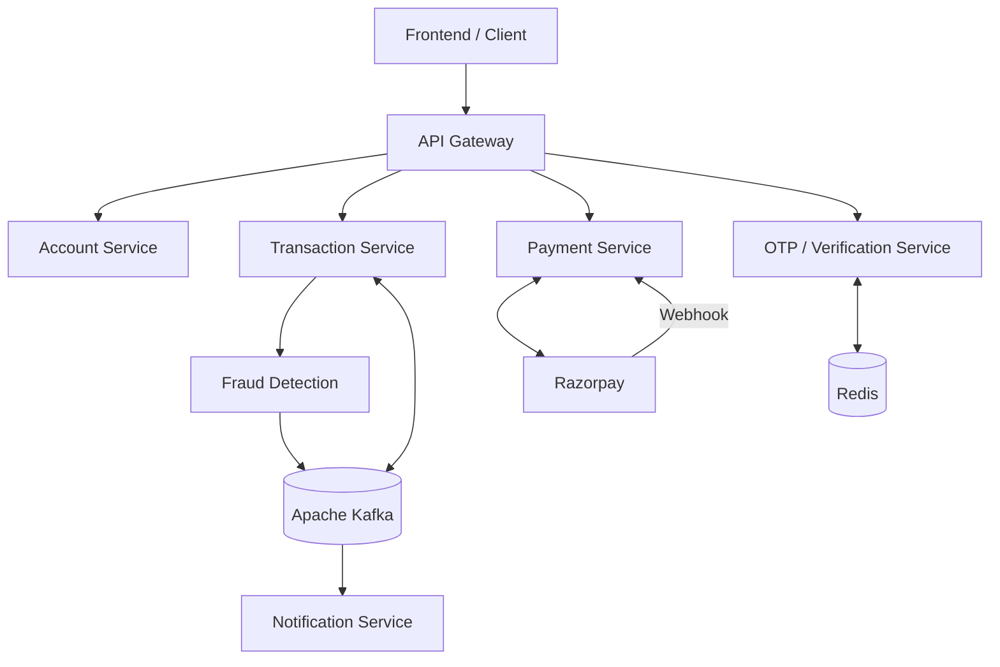
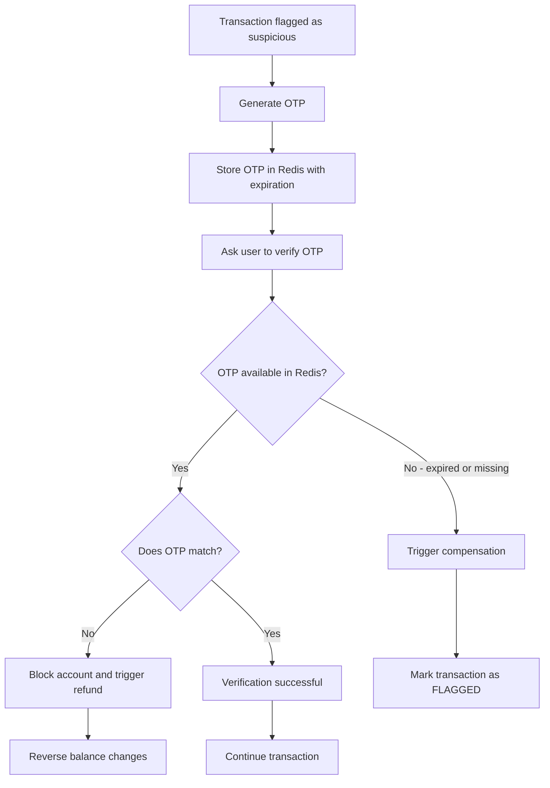
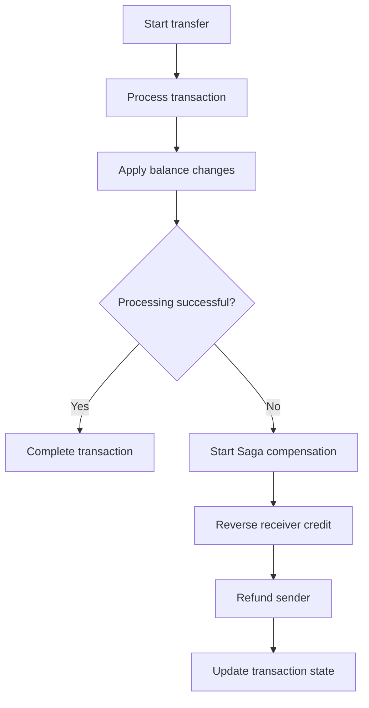
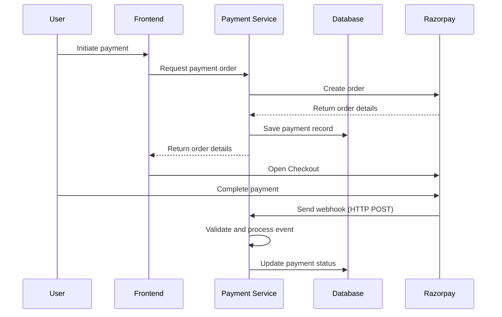

# Digital Banking System Release
### Real-Time Fraud Detection & Payment Processing

A microservices-based digital banking learning project built with **Java, Spring Boot, Apache Kafka, Redis, and Saga-based transaction compensation**.

---

## 📌 Overview

This project demonstrates a digital banking system with fund transfers, real-time fraud detection, OTP-based transaction verification, payment processing, and event-driven notifications.

The system separates business responsibilities into multiple backend services. Apache Kafka supports asynchronous communication, Redis stores temporary OTP data, and the Saga pattern coordinates compensating actions when a transaction cannot be completed.

> **Project Type:** Personal Learning Project  
> This project is intended to demonstrate backend development concepts and integration patterns. It is not a production banking platform and should not be used to process real customer funds.

## ✨ Key Features

| Feature | Description |
|---|---|
| **Fund Transfer** | Handles transfers between accounts and coordinates transaction processing. |
| **Real-Time Fraud Detection** | Detects suspicious transactions using velocity, average transaction amount, and account balance checks. |
| **OTP Verification** | Requires additional verification when a transaction is flagged as suspicious. |
| **Transaction Idempotency Guard** | Uses transaction states such as `PROCESSING` to help prevent duplicate processing. |
| **Saga Compensation** | Reverses previously applied balance changes when a transaction fails or is cancelled. |
| **Razorpay Integration** | Creates payment orders and handles payment status updates through webhooks. |
| **Event-Driven Notifications** | Notifies users about completed transactions, fraud detection, and payment failures. |

## 🧰 Technology Stack

| Category | Technologies |
|---|---|
| Language & Framework | Java, Spring Boot |
| Persistence | Spring Data JPA, Hibernate, Relational Database |
| Messaging | Apache Kafka |
| Caching & Temporary Storage | Redis |
| Architecture | Microservices, Event-Driven Architecture, API Gateway |
| Distributed Transactions | Saga Pattern |
| Payment Integration | Razorpay |
| Build & Containerization | Maven, Docker, Docker Compose |

## 🏛️ High-Level Architecture

The following diagram illustrates the main components and communication patterns.



### Core Components

- **API Gateway** — provides a common entry point and routes client requests to backend services.
- **Account Service** — handles account-related operations and balance updates.
- **Transaction Service** — coordinates fund transfers and manages transaction states.
- **Fraud Detection** — evaluates transaction activity against configured fraud patterns.
- **OTP Verification Service** — handles additional transaction verification.
- **Payment Service** — creates payment orders and processes payment gateway webhooks.
- **Notification Service** — handles transaction and security notifications.
- **Apache Kafka** — enables asynchronous communication between services.
- **Redis** — stores temporary OTP values with expiration.

## 🔍 Fraud Detection

The fraud detection process evaluates transactions using three main checks.

### 1. Velocity Check

Detects unusually frequent transactions within a short period.

**Example:** Multiple transactions initiated by the same user within one minute may be considered suspicious.

### 2. Average Transaction Amount Check

Compares the current transaction amount against the user's historical average transaction amount.

**Example:** A transaction that is several times higher than the user's average may trigger additional verification.

### 3. Account Balance Check

Checks whether the transaction amount represents an unusually large portion of the user's available balance.

**Example:** A transfer close to 90% of the user's balance may be flagged for verification.

> The thresholds above are illustrative examples. Actual thresholds should be configurable based on business rules and transaction data.

When a transaction is considered suspicious, the system can require OTP verification before allowing the transaction to continue.

## 🔐 OTP Verification Flow

OTP verification provides an additional security step for transactions flagged by fraud detection.



### Verification Scenarios

| Scenario | Expected Handling |
|---|---|
| **OTP expired or missing** | Redis returns no OTP value. Compensation is triggered and the transaction is marked as `FLAGGED`. |
| **OTP does not match** | The account is blocked according to the described flow, and the transaction is compensated/refunded. |
| **OTP matches** | Verification succeeds and transaction processing continues. |

## 🔁 Transaction Idempotency & Saga Compensation

Distributed transactions may involve multiple services and balance updates. If a later step fails, the system needs to reverse the effects that have already been applied.

### Idempotency Guard

For transactions requiring verification, the transaction state (for example, `PROCESSING`) acts as a guard against repeated processing.

This helps prevent the same transaction from being applied more than once when verification requests or events are repeated.

### Saga Compensation

If a transaction cannot be completed, the system performs compensating actions to reverse previously applied changes.

**Example compensation flow:**

1. A transfer is initiated by the sender.
2. The receiver's balance is credited as part of the transfer process.
3. Verification fails or the OTP expires.
4. The compensation flow reverses the receiver's credit.
5. The amount is credited back to the sender.
6. The transaction is updated to the appropriate failure or flagged state.



> A transaction status check alone does not guarantee exactly-once processing across distributed services. A robust implementation should also consider atomic state transitions, idempotency keys, and idempotent event consumers.

## 💳 Razorpay Payment Integration

The payment integration demonstrates how the backend creates a payment order and receives payment status updates asynchronously.

### Create Payment Order

1. The backend creates an order through Razorpay.
2. The backend saves the payment record in its database.
3. The backend returns the order details to the frontend.
4. The frontend opens the Razorpay Checkout experience.
5. The user completes the payment.

### Webhook Handling

After a payment event occurs, Razorpay sends an HTTP `POST` request to the backend webhook endpoint.

The backend receives the event and updates the corresponding payment status.



### Webhook Security Considerations

- Verify webhook signatures using the configured webhook secret.
- Do not trust payment status supplied only by the frontend.
- Handle duplicate webhook deliveries safely.
- Match each webhook event to the correct payment/order record.
- Keep API keys and webhook secrets outside source control.

## 🔔 Notification Scenarios

The notification flow covers important transaction and payment events.

| Event | Notification |
|---|---|
| Transaction completed | Notify both sender and receiver. |
| Fraud detected | Notify the affected user about suspicious activity or additional verification. |
| External payment service failure | Notify the user that the payment could not be completed. |

Notifications use event-driven communication so the main transaction flow does not need to perform every notification task synchronously.

## 🚀 Getting Started

The following steps provide a general setup guide. Use the actual configuration and module names available in your repository.

### Prerequisites

- Java (use the version required by the project)
- Maven
- Apache Kafka
- Redis
- A relational database configured by the project
- Docker and Docker Compose (if using the container setup)
- Razorpay test credentials (if testing payment integration)

### 1. Clone the Repository

```bash
git clone <your-repository-url>
cd <repository-folder>
```

### 2. Configure Application Properties

Review each service's configuration file, such as `application.yml` or `application.properties`.

Configure the required connection details for:

- Database
- Kafka brokers
- Redis
- Service-to-service communication
- Razorpay API credentials and webhook secret, if payment integration is enabled

Use environment variables or local, untracked configuration files for secrets. Never commit real credentials.

### 3. Build the Project

If the repository is configured as a Maven project:

```bash
mvn clean package
```

For a multi-module repository, run the command from the appropriate root directory or follow the module-specific build instructions.

### 4. Start Dependencies and Services

Start the required infrastructure, such as the database, Kafka, and Redis, using your local setup or the provided Docker Compose configuration.

Then start the backend services in the order required by their dependencies.

### 5. Test the Main Flows

Use the available frontend, API client, or Postman collection to test the flows supported by your implementation.

## 🧪 Suggested Test Scenarios

| Test | Expected Result |
|---|---|
| Normal transfer | Transaction completes and sender/receiver balances are updated. |
| High transaction velocity | Fraud detection flags the transaction for verification. |
| Transaction amount far above average | Additional verification is triggered. |
| Transaction uses a large portion of account balance | Transaction is flagged based on the configured rule. |
| Valid OTP | Verification succeeds and transaction processing continues. |
| Expired or missing OTP | Compensation is triggered and transaction is marked `FLAGGED`. |
| Incorrect OTP | Account blocking and compensation follow the configured flow. |
| Duplicate verification request | Transaction state/idempotency guard prevents duplicate application. |
| Payment webhook received | Payment record is updated based on the validated event. |
| Duplicate payment webhook | The same update is not applied more than once. |
| Payment gateway failure | Failure is handled and the user is notified. |

## 🔒 Security & Reliability Notes

This project is for learning and should not be treated as production-ready financial software.

A production implementation would require additional considerations, including:

- Strong authentication and authorization.
- Secure handling of credentials, OTPs, and personal data.
- OTP rate limiting, attempt limits, and expiration policies.
- Verified payment webhooks and duplicate-event protection.
- Atomic balance updates and concurrency control.
- Idempotent consumers and reliable event publishing.
- Audit logging, monitoring, and alerting.
- Reconciliation and operational handling for inconsistent payment or transaction states.
- Proper testing, security review, and compliance assessment.

**Never use real customer data, real banking credentials, or live payment credentials when experimenting with this learning project.**

## 📚 Learning Outcomes

Through this project, the main backend concepts explored include:

- Building RESTful services with Spring Boot.
- Separating business capabilities using microservices.
- Communicating asynchronously with Apache Kafka.
- Using Redis for temporary OTP storage and expiration.
- Applying fraud detection rules to transaction behavior.
- Coordinating distributed business operations with the Saga pattern.
- Handling payment orders and webhook-based updates.
- Designing for duplicate requests and event delivery.

## 🙌 Acknowledgement

This project was developed as a personal learning exercise based on the tutorial:

**[Full Project: How Banks Detect Fraud | Digital Banking System | Spring Boot + Kafka + Redis + SAGA](https://www.youtube.com/watch?v=7Upc4iCsSh4)** by Yeshendra Dhaker.

Please adjust the architecture, commands, configuration names, and feature descriptions to match the actual source code in this repository.

---

**Built for learning Java backend engineering and distributed system concepts.**
